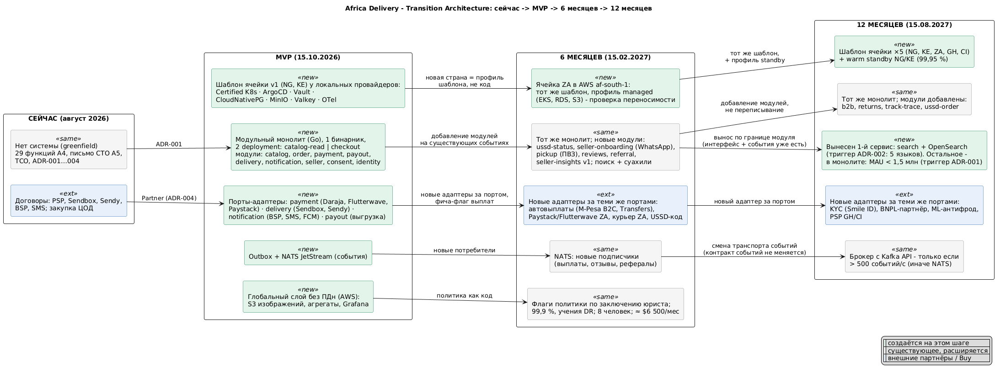

# Transition Architecture

Как MVP превращается в платформу на 5 стран **без переписывания**: сейчас -> MVP -> 6 месяцев -> 12 месяцев. Состояния совпадают с контрольными точками [roadmap](roadmap.md). Диаграмма: [transition-architecture.puml](transition-architecture.puml) -> [transition-architecture.png](transition-architecture.png).

## Состояния

| | **Сейчас** (август 2026) | **MVP** (15.10.2026) | **6 месяцев** (15.02.2027) | **12 месяцев** (15.08.2027) |
|-|-|-|-|-|
| Страны | - | NG, KE | NG, KE, **ZA** | NG, KE, ZA, GH, CI |
| Стиль | Решение ADR-001 | Модульный монолит на Go: 1 бинарник, 2 deployment (`catalog-read`, `checkout`) | Тот же монолит и те же 2 deployment. Новые модули: `ussd-status`, `seller-onboarding`, `pickup`, `reviews`, `referral`, `seller-insights` v1 | Тот же монолит + 1 выделенный сервис (поиск). MAU < 1,5 млн, поэтому дальнейший вынос не нужен (ADR-001) |
| Данные | Решение ADR-003 | Ячейки NG/KE у локальных провайдеров, PostgreSQL на ячейку, глобальный слой без ПДн | + ячейка ZA в AWS af-south-1 на managed-сервисах (EKS, RDS, S3): **первая проверка переносимости шаблона**. Флаги политики выставлены по заключению юриста (сентябрь 2026) | 5 ячеек: GH, CI - в hyperscaler или у локальных провайдеров по результату юридической проверки страны. Warm standby NG/KE |
| Интеграции | Договоры и KYC у PSP, Sendbox, Sendy, BSP, SMS | Порты `payment`, `delivery`, `notification` с адаптерами. Выплаты продавцам - выгрузка для массовой выплаты в кабинете PSP | + Paystack и Flutterwave ZA, курьерский партнёр ZA за портом `Carrier`, агентские ПВЗ Sendbox/Sendy, **автоматические выплаты** (M-Pesa B2C, Transfers), USSD-код агрегатора | Новые адаптеры: KYC (Smile ID), BNPL, ML-антифрод, PSP для GH/CI |
| Поиск | - | PostgreSQL FTS, EN/FR | PostgreSQL FTS + конфигурация суахили | OpenSearch, 5 языков (триггер ADR-002) |
| События | - | Outbox + NATS JetStream | NATS. Новые подписчики: выплаты, отзывы, рефералы | NATS. Брокер с Kafka API - только при > 500 событий/с |
| Доступность | - | 99,9 % (путь заказа) | 99,9 %. ZA - мультизонно силами AWS. Учения DR раз в квартал. GMV run-rate ниже триггера $37 млн | 99,95 % (GMV >= $37 млн, [Task3](../Task3/availability-strategy.md)) |
| Команда | CTO, архитектор, 6 контракторов | 6 контракторов | 8 человек: найм разморожен с января (+1 Go, +1 QA/поддержка) | 11 человек |
| Облако + SaaS | - | $4 750/мес | ≈ $6 500/мес. **Пересмотр лимита с CFO**: $5 000 действовали первые 6 месяцев (A6, п. 1) | ≈ $9 300/мес |

## Что меняется на каждом шаге и почему без переписывания

| Шаг | Что меняется | Механизм, который это обеспечивает | Что **не** трогаем |
|-|-|-|-|
| Сейчас -> MVP | Создаётся всё | Модули с явными интерфейсами. Архитектурные тесты в CI запрещают модулям обращаться к таблицам друг друга | - |
| MVP -> 6 мес | Ячейка ZA на managed-сервисах | **Шаблон ячейки** (Helm + ArgoCD ApplicationSet) с профилем `managed: true`: тот же чарт, вместо CloudNativePG и MinIO - RDS и S3 по тем же протоколам (PostgreSQL, S3 API). Политика резидентности ZA - конфигурация ([ADR-003](../Task4/adr-003-data-residency.md)) | Код приложения |
| MVP -> 6 мес | Автоматические выплаты вместо выгрузки | Порт `PayoutProvider` был с MVP. Адаптер «выгрузка» заменяется адаптерами B2C и Transfers за фича-флагом | Модули `order`, `ledger`, расчёт резерва |
| MVP -> 6 мес | USSD-статус, онбординг через WhatsApp, ПВЗ, отзывы, рефералы | Новые модули подписываются на существующие события (`OrderStatusChanged`, `Delivered`). ПВЗ - новый тип адреса в `delivery`. USSD читает статус из кеша (ADR-002) | Существующие модули |
| MVP -> 6 мес | Маршруты PSP для ZA, курьер ZA | Маршрутизация оркестратора - конфигурация ([ADR-004](adr-004-payment-provider.md)). Курьер - новый адаптер за `Carrier` | Модуль `payment` |
| MVP -> 6 мес | Заключение юриста | Флаги экспорта в политике OPA | Код |
| 6 -> 12 мес | Новые страны (GH, CI) | Тот же шаблон ячейки, профиль по результату юридической проверки | Код приложения |
| 6 -> 12 мес | Новые партнёры (KYC, BNPL, PSP GH/CI) | **Порты и адаптеры**: `KycProvider`, `PaymentProvider` | Модули-потребители |
| 6 -> 12 мес | Новые функции (B2B, track & trace, возвраты, USSD-заказ) | Новые модули на существующих событиях | Существующие модули |
| 6 -> 12 мес | Вынос поиска в сервис | Интерфейс модуля `catalog` + события `ProductUpdated` уже есть: сервис с OpenSearch - их новый потребитель (паттерн strangler) | Вызывающий код меняет только адрес |
| 6 -> 12 мес | Ступень 99,95 % | Warm standby во втором ЦОДе: тот же шаблон, профиль `standby: true` | Приложение |
| По триггеру | Транспорт событий NATS -> Kafka API (> 500 событий/с) | Схема событий (CloudEvents) и outbox не зависят от транспорта | Издатели и подписчики |
| По триггеру (Год 2) | Свой dispatch-слой логистики | Новый адаптер за портом `Carrier` ([capability-map](capability-map.md)) | Заказ и уведомления |

## Почему состояние «6 месяцев» важно

Это первая точка, где проверяются два ключевых обещания архитектуры:

1. **Новая страна = конфигурация.** Ячейка ZA разворачивается из того же шаблона, причём на другом типе инфраструктуры: managed-сервисы AWS вместо операторов у локального провайдера. Если для этого понадобятся изменения кода, это сигнал пересмотреть шаблон до выхода в GH и CI.
2. **Партнёр = адаптер.** Автоматические выплаты, курьер ZA и PSP ZA подключаются без правки модулей заказа и платежей.

Критерий готовности из [roadmap](roadmap.md): ячейка ZA развёрнута без изменения кода приложения.

## Что сознательно не входит в 12 месяцев

Микросервисы на 40–50 сервисов, Istio, мультирегион 99,99 %, Oracle, свой эквайринг. Каждое из этих решений имеет измеримый триггер (ADR-001, ADR-004, [Task3](../Task3/availability-strategy.md)) и **не требует переписывания**, когда триггер сработает. Письмо CTO (A5) остаётся целевым направлением.

## Assumptions

- MAU на конец Года 1 - около 400 тыс. ([tco-model](../Task2/tco-model.xlsx)). Триггер ADR-001 (MAU > 1,5 млн) ожидается в Году 2.
- Курьерский партнёр в ЮАР выбирается закупкой до декабря 2026. Sendbox и Sendy ЮАР не покрывают.
- Размещение ячеек GH и CI зависит от их законов о данных - отдельная юридическая проверка до выхода в страну.
